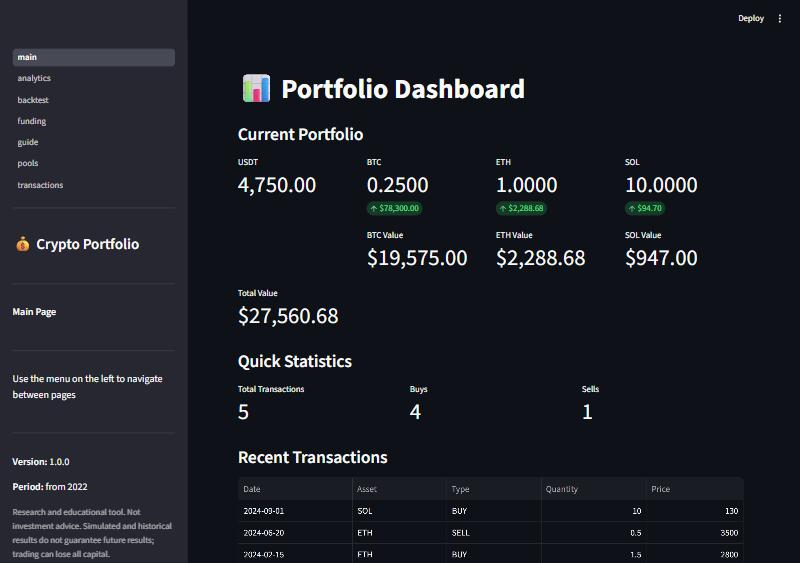
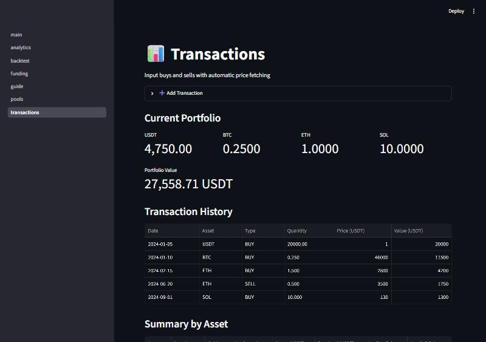
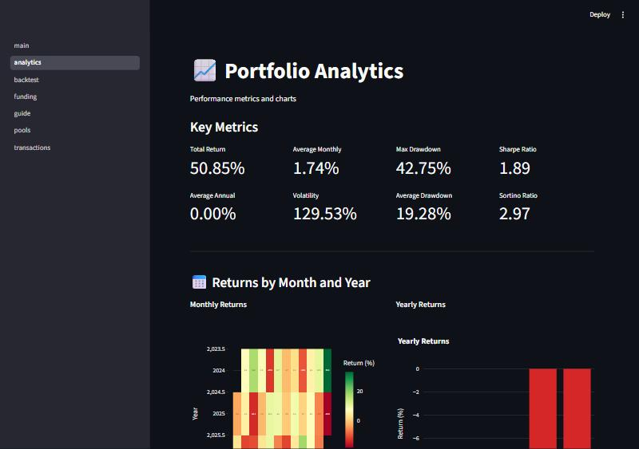
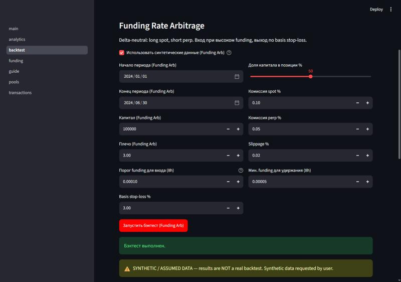

# Crypto Portfolio Tracker

> Research and educational tool. Not investment advice. Simulated and historical results do not guarantee future results; trading can lose all capital.

A small local app for tracking your own crypto portfolio. You enter your buys and sells by hand; the app fetches prices from Binance (public data, no API keys), shows what you hold and what it is worth, and calculates return and risk numbers. It never places orders.



## What it does

- **Dashboard**: current holdings, prices, total value, recent transactions, value history chart.
- **Transactions**: add and delete buys and sells (by quantity, percent of position or USDT amount); prices are filled in from Binance.
- **Funding and Pools**: enter monthly Coin-M funding % and USDT pool APY; income is calculated from your average positions.
- **Analytics**: total / monthly / annual return, volatility, Sharpe, Sortino, drawdowns, monthly and yearly return heatmaps.
- **Backtest**: two research backtests (funding arbitrage, alt market-neutral). Results built on synthetic or assumed data are flagged with a warning.
- **Guide**: short text guide to those backtests.

## Install

You need Python 3.11 or newer and an internet connection (for prices).

```bash
python -m venv .venv
# Windows: .venv\Scripts\activate    Linux/macOS: source .venv/bin/activate
pip install -r requirements.txt
```

## Run

```bash
streamlit run main.py
```

Open http://localhost:8501. The app listens on `127.0.0.1` only and has no login, so do not expose it to a network.

Your data is stored in `data/portfolio.db` (created on first run, not in git). Back it up by copying the file while the app is stopped.

## Main pages

| Transactions | Analytics |
|---|---|
|  |  |



Screenshots use made-up test data.

## Tests

```bash
pip install -r requirements-dev.txt
python -m pytest -q
```

The tests use temporary databases and mocked prices; they never touch your real data.

## Known limitations

- Adding or withdrawing USDT is counted as performance, so return and drawdown numbers are distorted when you move money in or out.
- Volatility, Sharpe and Sortino are indicative only (the value history is not a regular daily series).
- History starts at 2022-01-01; earlier transactions are ignored.

Full list: `docs/REVIEW.md` and `docs/QA.md`. Changes: `CHANGELOG.md`.
